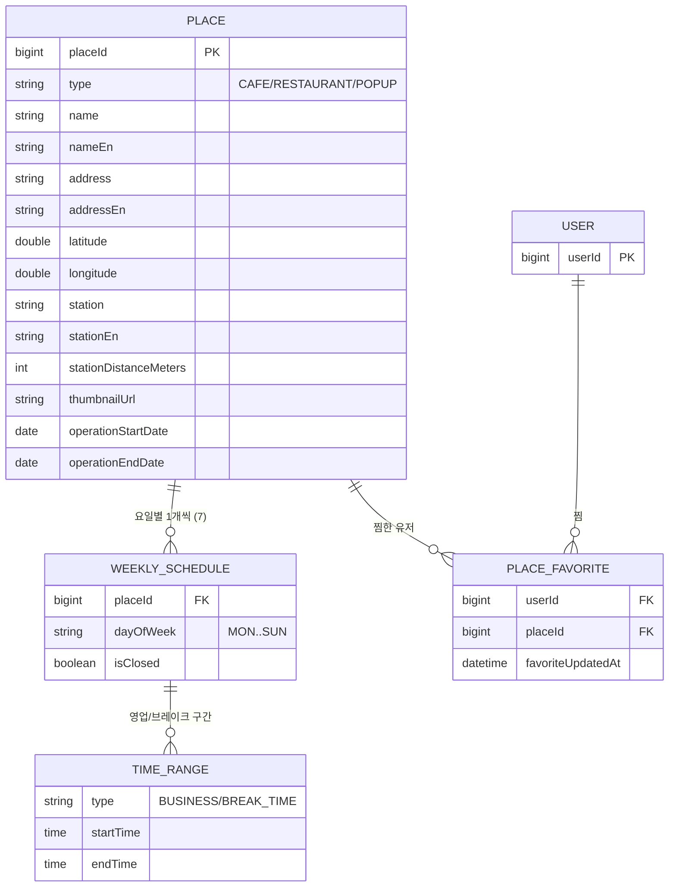

# 성수 콘텐츠 데이터 구조 (ERD)

2026-10-24

Swagger 응답/요청 모델로 역추론한 구조다. 실제 DB 테이블명과 PK/FK 전략은 백엔드 코드 확인이 필요하다. 필드별 상세는 [데이터 정의서](./data-dictionary.md)를 참고한다.

장소 1건은 요일별 스케줄 7개를 갖고, 각 스케줄이 영업/브레이크 시간대를 N개 가진다. 찜은 유저-장소 다대다 관계다.
